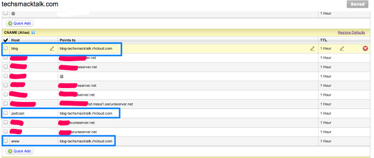

Want to deploy your Ruby on Rails application on OpenShift? Then follow these steps.

:::note
This post is from 2013 and covers OpenShift v2 and the `rhc` tool, which Red Hat retired in 2017. Today's OpenShift is built on Kubernetes and works very differently. I'm keeping the post as a record of how it worked then.
:::

**1.** Go to [openshift.com](http://www.openshift.com) and create an account.

**2.** Click MY APPS > Create an application ([https://openshift.redhat.com/app/console/application_types](https://openshift.redhat.com/app/console/application_types)) and select Ruby on Rails as the application type.

**3.** Enter a name for your application. If this is your first time, make sure you have a unique namespace. You can change it here: [https://openshift.redhat.com/app/account](https://openshift.redhat.com/app/account)

**4.** Clone your git repo to your local machine using the SSH URL provided. For example:

```bash
git clone ssh://cb46d233933f4e79eddc@railsapp-appsource.rhcloud.com/~/git/railsapp.git/
cd railsapp/
```

**5.** Or, which I recommend, use the `rhc` client tool to create the app on OpenShift:

```bash
sudo gem install rhc   # first install the rhc gem
rhc app create -a railsapp -t ruby-1.9
```

**6.** Then add a database cartridge to your Rails application:

```bash
rhc cartridge add -a railsapp -c mysql-5.1
```

**7.** Then pull the example Rails code from GitHub:

```bash
git remote add upstream -m master git://github.com/openshift/rails-example.git
git pull -s recursive -X theirs upstream master
```

**8.** Then change your `database.yml`, and put this config in for production only:

```erb
production:
  adapter: mysql2
  encoding: utf8
  database: <%=ENV['OPENSHIFT_APP_NAME']%>
  pool: 5
  host: <%=ENV['OPENSHIFT_MYSQL_DB_HOST']%>
  port: <%=ENV['OPENSHIFT_MYSQL_DB_PORT']%>
  username: <%=ENV['OPENSHIFT_MYSQL_DB_USERNAME']%>
  password: <%=ENV['OPENSHIFT_MYSQL_DB_PASSWORD']%>
  socket: <%=ENV['OPENSHIFT_MYSQL_DB_SOCKET']%>
```

Leave the development and test environments on the mysql adapter.

**9.** Now, in your application directory, look for the `.openshift` folder. There you will find the `.openshift/action_hooks/deploy` file:

```bash
pushd ${OPENSHIFT_REPO_DIR} > /dev/null
  bundle exec rake db:migrate RAILS_ENV="production"
popd > /dev/null
```

Commands between the `pushd` and `popd` lines run automatically after your code is updated on OpenShift. So if you have other commands, like starting Resque or copying some files after a deploy, add them here.

**10.** Now that we have made our changes... push it!

```bash
git add .
git commit -m "Configure database.yml, Gemfile and .openshift files"
git push
```

**11.** That's all. Now open your Rails app's URL.

**12.** Here you will find details of all the environment variables available on OpenShift: [https://www.openshift.com/page/openshift-environment-variables](https://www.openshift.com/page/openshift-environment-variables)

**13.** If you want to use your own domain name (e.g. www.yourdomain.com) for your OpenShift Rails app, create a URL alias as shown below:

```bash
rhc alias add railsapp www.yourdomain.com
```

Then change the CNAME records in your DNS provider's account:



**14.** If your application needs a persistent directory for its data, use `app-root/data/`. You can access it in your application through the environment variable `OPENSHIFT_DATA_DIR`.

**15.** If you want to remove a cartridge:

```bash
# Format:
rhc cartridge remove shortname --app appname --confirm

# Example:
rhc cartridge remove mysql-5.1 --app railsapp --confirm
```
