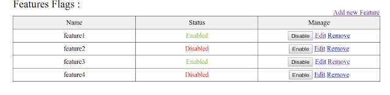
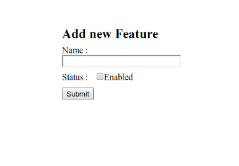

You must have faced a situation while developing where you need to turn some features of your Rails application on or off.

So here is a Ruby gem, feature_flags, that provides this functionality. Using it, you can manage different features in your Rails application.

To add the gem to your Rails application, add this line to your application's Gemfile:

```ruby
gem 'feature_flags'
```

Then run:

```bash
rails generate feature_flags:install
```

This will generate 3 files:

1. an initializer in `config/initializers/feature_flags.rb`
2. a migration for the `Feature` model
3. `feature.rb`

It also adds a route to your Rails application:

```ruby
resources :features
```

Then run:

```bash
rake db:migrate
```

In the `feature_flags.rb` initializer, you can set which layout the views should use:

```ruby
FeatureFlags.configure do |config|
  config.layout = "application"
end
```

Here is what you can do with it:

```ruby
FeatureFlags.enabled?(:feature_name)           # check whether a feature is enabled
FeatureFlags.enable_all                        # enable all features in your app
FeatureFlags.disable_all                       # disable all features in your app
FeatureFlags.set_disabled(:feature_name)       # disable a feature
FeatureFlags.create_and_enable(:feature_name)  # create a feature and enable it
FeatureFlags.enable(:feature_name)             # enable a feature
```

If you want to generate the views, use:

```bash
rails generate feature_flags:views
```

It also helps with the branching problem in Rails applications, where we merge branches with different features and then have to resolve conflicts. With feature_flags, you just merge, and turn the feature on or off in the app. For example:

```ruby
if FeatureFlags.enabled?(:feature_name1)
  # your code for feature_name1
end
```

Here are some screenshots. The main index view (`/feature_flags`):



Adding a new feature:


