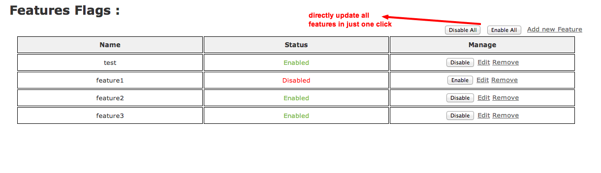

Back again with new features in the Ruby gem feature_flags (0.1.0).

Here is my [blog post on the old version of feature_flags](/manage-different-features-in-our-ruby/). I recommend going through it first if you haven't, to learn about the other features available in this gem.

Memoization of features is the main change in this version, and it really improved performance. It's much faster now.

What's new?

**1. Memoization**

In previous versions, it fired an SQL query every time you checked whether a feature was enabled:

```ruby
FeatureFlags.enabled?(:feature_name)
```

Worried about that? Now you don't need to be. It fires the SQL query only when something has changed in the database, and memoizes the result, which speeds it up a lot.

**2. Check multiple features at a time**

There may be situations where you need to check several features together:

```ruby
if FeatureFlags.enabled?(:feature_name1) && FeatureFlags.enabled?(:feature_name2) && FeatureFlags.enabled?(:feature_name3)
  ## some code
else
  ## some code
end
```

That gets long quickly, so now you can do it like this:

```ruby
if FeatureFlags.enabled?([:feature_name1, :feature_name2, :feature_name3])
  ## some code
end
```

So when you have more than one feature to check at once, pass them as an array of feature names. If you have a single feature to check, just write:

```ruby
if FeatureFlags.enabled?(:feature_name)
  ## some code
end
```

**3. Check if any of the given features is enabled**

```ruby
if FeatureFlags.enabled_any?([:feature_name1, :feature_name2, :feature_name3])
  ## some code
end
```

This runs the code inside if any one of `:feature_name1`, `:feature_name2` or `:feature_name3` is enabled.

**4. UI changes**

You can now do everything on a single page (add, edit, enable, disable, remove):



If you are already using a previous version (<= 0.0.3) and want to migrate to this version (0.1.0), then after updating the gem, just add the following line to your model:

```ruby
include FeatureFlags::FeatureBase
```

And if you had generated the views before, generate them again to get the updated ones:

```bash
rails generate feature_flags:views
```

That's it, you are done. :)
