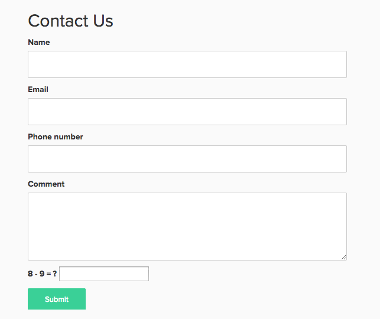

When your application has a form that's open to everyone, for example a Contact Us form, you will get spammed! So what can we do about it?

Well, one option is to put every form behind authentication... OR we can use a captcha. So here is how you can implement your own simple captcha in Ruby on Rails.

:::note
The first version of this post stored the captcha in a Base64-encoded YAML string. That was a mistake: Base64 is not encryption, so a bot could read or forge the captcha, and calling `YAML.load` on a value from the request is unsafe. The code below signs the captcha with Rails' message verifier instead.
:::

First of all, we will create a `Captcha` class in the `lib` folder:

```ruby title="captcha.rb"
class Captcha
  OPERATORS = %w[+ - *].freeze

  attr_reader :operand1, :operand2, :operator

  def initialize(operand1: rand(1..10), operand2: rand(1..10), operator: OPERATORS.sample)
    @operand1 = operand1
    @operand2 = operand2
    @operator = operator
  end

  # Signed, not just encoded: the form can carry these values, but if anyone
  # changes them, verification fails.
  def self.verifier
    Rails.application.message_verifier(:captcha)
  end

  # Returns nil if the secret was tampered with or has expired.
  def self.from_secret(secret)
    data = verifier.verified(secret.to_s)
    data && new(**data.symbolize_keys)
  end

  def secret
    self.class.verifier.generate(
      { operand1: operand1, operand2: operand2, operator: operator },
      expires_in: 10.minutes
    )
  end

  def correct?(value)
    value.to_s.strip == result.to_s
  end

  def question
    "#{operand1} #{operator} #{operand2} = ?"
  end

  private

  def result
    operand1.public_send(operator, operand2)
  end
end
```

The question is shown to the user anyway, so there is nothing to hide. What matters is that nobody can submit a captcha of their own making with an answer they already know. The signature takes care of that, and `expires_in` stops an old solved captcha from being reused forever.

Then in your controller:

```ruby
class ContactsController < ApplicationController
  def new
    @captcha = Captcha.new
  end

  def create
    captcha = Captcha.from_secret(params[:captcha_secret])

    if captcha&.correct?(params[:captcha])
      ContactsMailer.notify(contact_params).deliver_later
      redirect_to root_path, notice: "Your message has been sent successfully"
    else
      flash.now[:alert] = "Please make sure you entered the correct value for the captcha."
      # Show a different captcha each time the form is rendered
      @captcha = Captcha.new
      render :new, status: :unprocessable_entity
    end
  end
end
```

In your view:

```erb
<div class="field">
  <%= hidden_field_tag :captcha_secret, @captcha.secret %>
  <%= label_tag :captcha, @captcha.question %>
  <%= text_field_tag :captcha, "" %>
</div>
```

That's it. And it will look similar to this:


