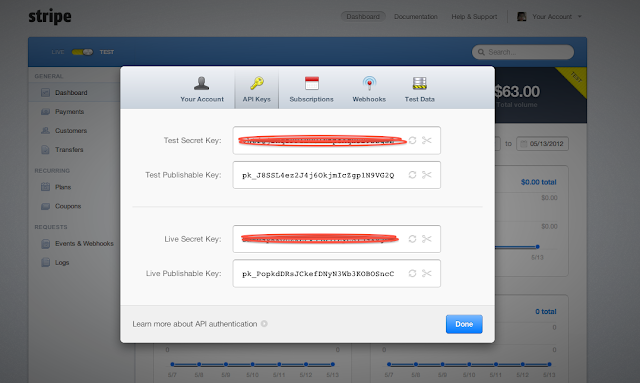
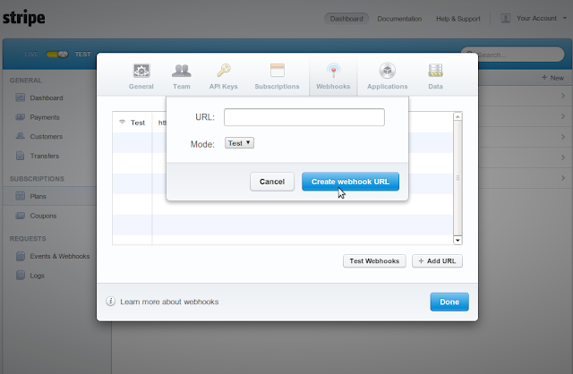
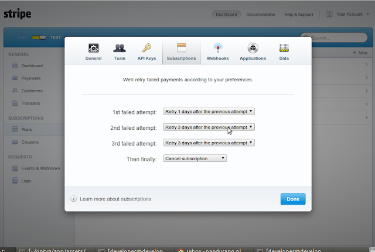

Here is a simple way to integrate Stripe into a Rails application. If you ever need to process credit card payments in your Rails application, Stripe is worth a look: it's easy to set up, very developer friendly, and charges per transaction with no monthly fees.

:::note
This post is from 2013. Stripe.js v1 and the card-token flow below have since been retired. For new work, use [Stripe Checkout or the Payment Element](https://docs.stripe.com/payments). The webhook part still applies, and I have updated it to verify Stripe's signature, which you should always do.
:::

**1. Create an account** at [Stripe](https://stripe.com).

**2. Add the gem to your Gemfile:**

```ruby
gem 'stripe'
```

**3. Create `config/initializers/stripe.rb`** and add your Stripe keys to it:

```ruby
Stripe.api_key = ENV.fetch("STRIPE_SECRET_KEY")
STRIPE_PUBLIC_KEY = ENV.fetch("STRIPE_PUBLIC_KEY")
```

You will get these keys from your Stripe account:



**4. Add these 2 lines to `layouts/application.html.erb`:**

```erb
<%= javascript_include_tag "https://js.stripe.com/v1/", "application" %>
<%= tag :meta, :name => "stripe-key", :content => STRIPE_PUBLIC_KEY %>
```

This adds Stripe's JavaScript API and sets your Stripe publishable key.

Then create the payment form:

```erb
<%= form_tag(your_payment_path, method: :post, id: "stripe-form") do %>
  <div class="field">
    <%= label_tag :email %>
    <%= email_field_tag :email %>
  </div>
  <div class="field">
    <%= label_tag :card_number, "Credit Card Number" %>
    <%= text_field_tag :card_number, nil, name: nil, class: 'credit-number' %>
  </div>
  <div class="field">
    <%= label_tag :card_code, "Security Code on Card (CVV)" %>
    <%= text_field_tag :card_code, nil, name: nil, class: 'credit-security' %>
  </div>
  <div class="field">
    <%= label_tag :card_month, "Card Expiration" %>
    <%= select_month nil, {add_month_numbers: true}, {name: nil, id: "card_month", class: "card-expiry-month"} %>
    <%= select_year nil, {start_year: Date.today.year, end_year: Date.today.year + 15}, {name: nil, id: "card_year", class: "card-expiry-year"} %>
  </div>
<% end %>
<div id="stripe_error">
  <noscript>JavaScript is not enabled and is required for this form. Please enable it in your web browser settings.</noscript>
</div>
```

The card fields have `name: nil`, so the card details are never sent to your server. Make sure no payment information gets saved in your database.

Then add the following JavaScript to send the card details to Stripe and submit the form with the token it returns:

```javascript
function stripeResponseHandler(status, response) {
  if (response.error) {
    $("#stripe_error").text(response.error.message);
  } else {
    var form$ = $("#stripe-form");
    var token = response['id'];
    form$.append("<input type='hidden' name='stripeToken' value='" + token + "'/>");
    form$.get(0).submit();
  }
}

$(document).ready(function() {
  Stripe.setPublishableKey($('meta[name="stripe-key"]').attr('content'));
  $("#stripe-form").submit(function(event) {
    $('.signup-button').attr("disabled", "disabled");
    Stripe.createToken({ number: $('.credit-number').val(),
                         cvc: $('.credit-security').val(),
                         exp_month: $('.card-expiry-month').val(),
                         exp_year: $('.card-expiry-year').val()
                       }, stripeResponseHandler);
    return false;
  });
});
```

**5. On form submit, create a Stripe customer,** which subscribes the user to the plan with the id `stripe_plan_id`.

To create a new plan, go to the dashboard, then to Plans, where a small wizard walks you through the process. You can also set a trial period there. If you want users to get 15 days free, you just set it up on the dashboard, no code needed!

```ruby
customer = Stripe::Customer.create(email: params[:email], card: params[:stripeToken], plan: stripe_plan_id)
```

Stripe returns the customer, with its id. Make sure you store `customer.id` in your database against that user, so you can find their Stripe customer later.

**6. Handle Stripe errors.** See the list here: [https://docs.stripe.com/api/errors](https://docs.stripe.com/api/errors)

**7. Handle Stripe events.** Depending on your application, you will want to react to the events Stripe sends for every transaction. You can see all the event types here: [https://docs.stripe.com/api/events/types](https://docs.stripe.com/api/events/types)

**8. In your Stripe account, add the webhook URL** `https://your-url/stripe_events`:



Then in `routes.rb`:

```ruby
post "/stripe_events", to: "events#stripe_events", as: :stripe_events
```

Now you can handle Stripe events in `EventsController#stripe_events`. Always check Stripe's signature first. Without it, anyone who finds the URL can send a fake "payment succeeded" event:

```ruby
class EventsController < ApplicationController
  skip_forgery_protection only: :stripe_events

  def stripe_events
    event = Stripe::Webhook.construct_event(
      request.body.read,
      request.headers["Stripe-Signature"],
      ENV.fetch("STRIPE_WEBHOOK_SECRET")
    )
    # event.type tells you which Stripe event this is
    head :ok
  rescue JSON::ParserError, Stripe::SignatureVerificationError
    head :bad_request
  end
end
```

Using these events, you can update your application, for example activating or deactivating users depending on whether their payment went through.

**9. If a subscription payment fails** for some reason, you can choose what Stripe does about it in your account settings:



**10. Or use the `stripe_event` gem,** which also gives you a way to handle Stripe events.
